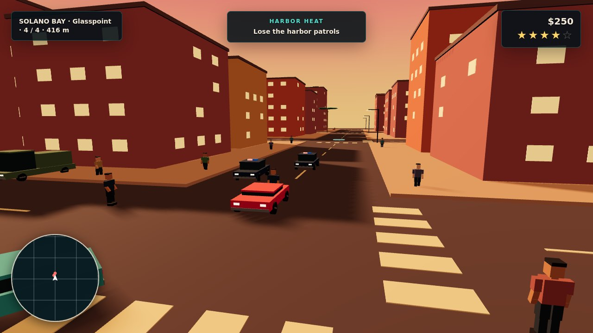
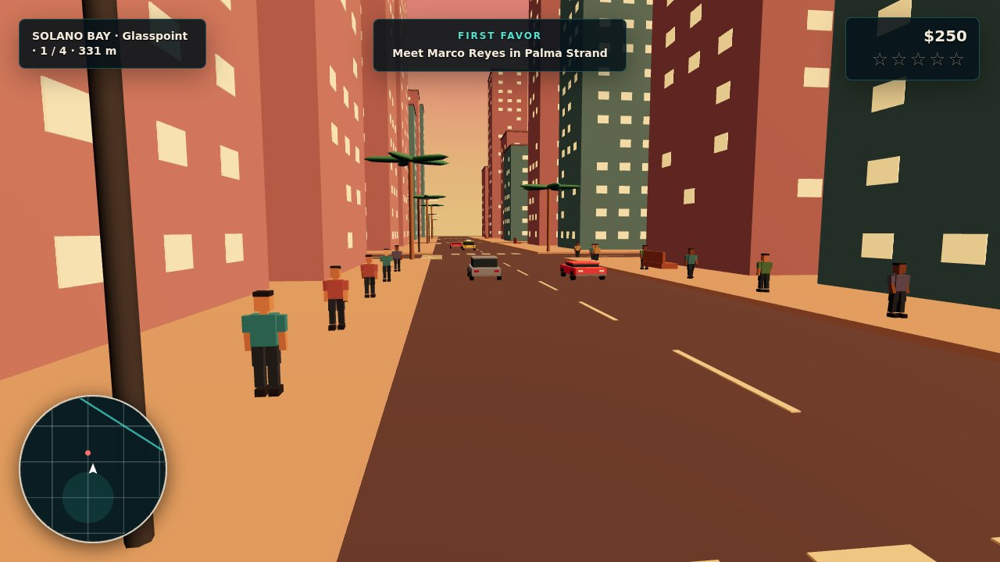
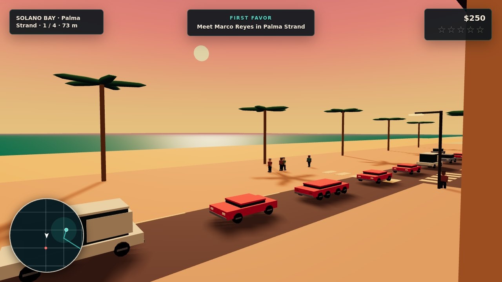
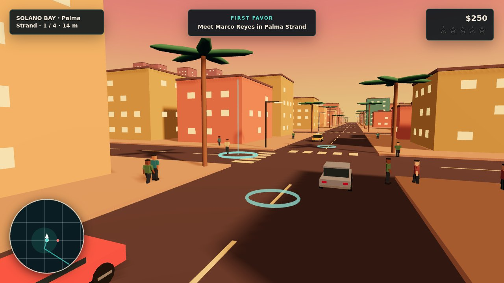

# Sunfall v2 — Solano Bay

[](https://make.fun/bounty/gta6-01?utm_source=github&utm_medium=readme&utm_campaign=gta6-01)
[](https://make.fun/bounty/gta6-01/leaderboard?utm_source=github&utm_medium=readme&utm_campaign=gta6-01)
[](https://make.fun/bounty/gta6-01?utm_source=github&utm_medium=readme&utm_campaign=gta6-01)

Explore 6 districts, take on 8 story missions, drive 6 vehicle kinds, face 5 wanted levels, and tackle 4 repeatable activities—with cash, story progress, and your return location saved in your browser.

Solano Bay glows at the edge of night. Marco Reyes offers a small favor at his coastal garage, but each delivery draws you deeper into a crew's unfinished business. Work with Nico Vale, Suri Calder, and Lena Voss, carry the ledger across the bay, and find a way home without bringing the patrols with you.

## Play

Use Node.js 22.18 or newer. From the repository directory:

```sh
node serve.ts --port 4173
```

Open **http://localhost:4173/game/index.html** in a desktop browser with WebGL enabled, then select **New Game**. No install or external asset service is needed. The first job starts at the Strand apartment; follow the teal destination ring and mission tracker. Press E near a destination to advance it. A driving stage requires a car; an escape stage requires cleared heat and distance from patrols.

F enters a nearby unlocked car at its door. Crimes increase heat when witnessed; break sight and keep your distance to cool it down. T starts the nearest repeatable activity: Taxi Fare, Street Race, Courier Run, or Stash Recovery. Starting an activity replaces the current job; Continue restores campaign progress rather than an unfinished mission stage.

Progress saves periodically and on pause. **Continue** reloads it on the same browser and origin. **New Game** clears that save. Browser storage must be available for persistence.

## Controls

| Input | Action |
| --- | --- |
| W / A / S / D or arrow keys | Move on foot; accelerate, reverse, and steer in a car |
| Shift | Run on foot |
| Mouse movement after clicking the scene | Turn the follow camera |
| F | Enter a nearby car / exit at low speed |
| Space | Brake |
| E | Interact with the current mission destination |
| T | Start the nearest repeatable activity |
| M | Hear from the current contact in a dialogue caption |
| 1 / 2 | Select fists / pistol |
| Q | Aim the pistol along the camera direction |
| Left mouse button | Punch / fire |
| Esc or P | Pause / resume; pausing also saves |

## Screenshots

Captured from this build at 1280 × 720 with the game HUD visible.






## Checks and packaging

```sh
node tests/smoke.cjs
MAKEFUN_OUTPUT_DIR=$HOME/sunfall-v3/output node main.ts
```

The package contains the self-contained `game/`, four JPEG captures in `screenshots/`, and `dossier.json`. `tests/browser-session.py` runs the live WebGL playtest (`play`) or stages and captures all four scenes (`capture`) using Playwright. It starts `node serve.ts` on port 4175 and uses Chrome at `/usr/bin/google-chrome`; the supplied environment runs it with `~/pw-venv/bin/python`.
